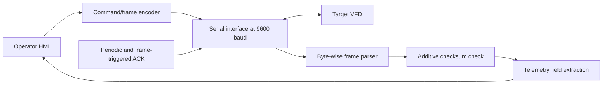
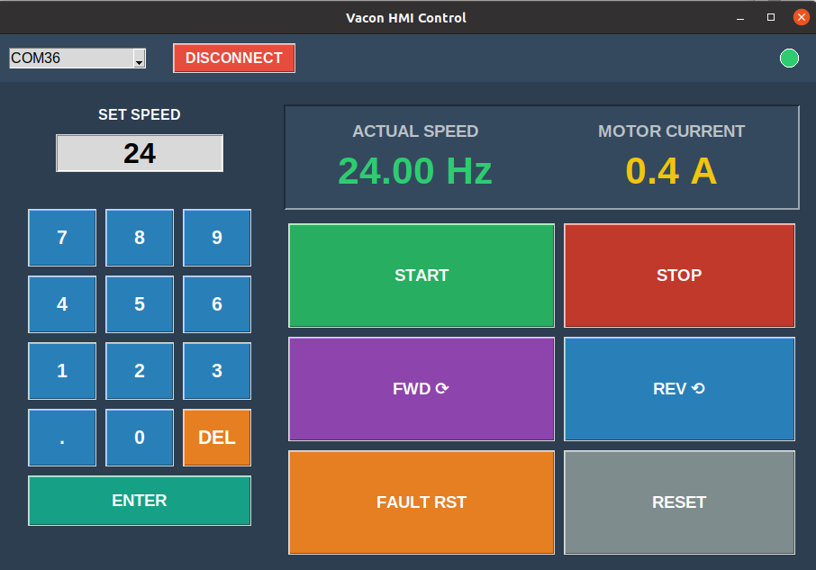
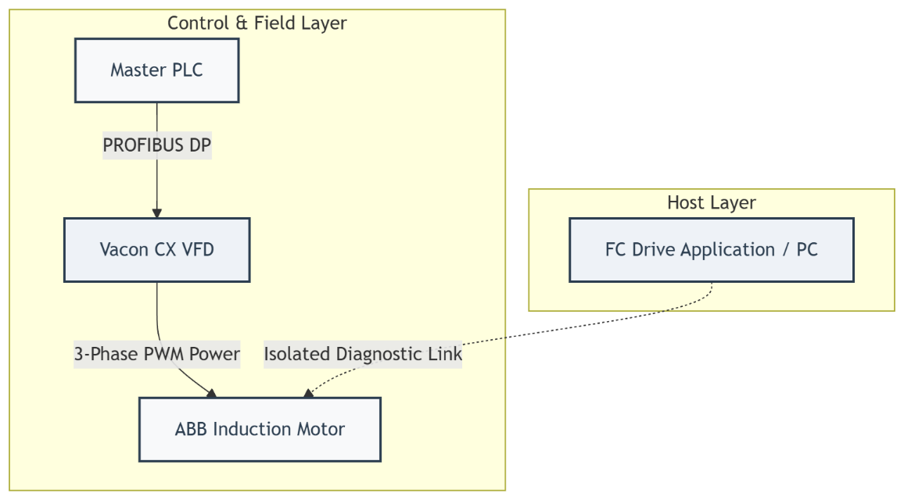
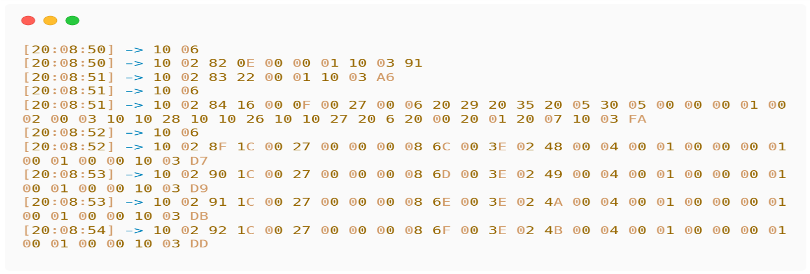

# Reverse Engineering a Proprietary Legacy VFD Protocol for Open-Source IIoT Integration

**Research software companion · 2026**  
**Institution:** Military Technical College (MTC), Cairo, Egypt  
**Associated paper:** *Reverse Engineering a Proprietary Legacy Variable Frequency Drive Protocol for Open-Source IIoT Integration*  
**Conference:** 10th International Undergraduate Research Conference (IUGRC), Military Technical College, 12–14 July 2026

> **Research status and safety.** This repository contains an experimental, device-specific Python HMI that transmits commands to a variable-frequency drive (VFD). It is not a safety controller, does not provide a certified emergency-stop function, and must not be deployed directly on production or hazardous machinery. The serial protocol described here is inferred from experimental observations, not an official VACON specification.

## Paper and project links

- **Conference website:** [10th IUGRC / official conference portal](https://iugrc.conferences.ekb.eg/)
- **MTC conference announcement:** [Official MTC announcement](https://www.mtc.edu.eg/mtcwebsite/ReadMore.aspx?id=141)
- **Direct paper URL / DOI:** *Add the exact publisher or proceedings URL here when confirmed.* The uploaded manuscript did not contain a DOI or stable paper-specific URL, and this README intentionally does not invent one.

## Project overview

The research investigates how communication already exchanged with a legacy VACON CX drive can be observed and interpreted to support an alternative monitoring and control interface. The software included here is the **active HMI/client implementation**: it opens a serial port, transmits initialization and acknowledgement messages, sends drive-control requests, parses incoming frames, and displays selected telemetry fields.

The supplied `code.py` is **not** the passive sniffing utility. The research manuscript refers to a separate sniffer (`sniffing.py`) and captured serial traces; those executable capture tools and machine-readable raw logs are not included in this release. The screenshot of a trace below is retained as a human-readable excerpt only.

### Software data path



*Figure: Logical code path only. This is not an electrical wiring or safety architecture diagram.*

## Visual documentation

### HMI screenshot



*Figure 1. Screenshot of the Tkinter HMI supplied with this research artifact. The displayed values document one UI state; they should not be treated as a calibrated measurement record or validation result by themselves.*

### Existing system architecture



*Figure 2. Existing system architecture reproduced from the supplied project manuscript. It is a system-level diagram, not a wiring diagram for connecting an adapter to a live drive.*

### Representative serial trace



*Figure 3. Readable excerpt of serial traffic reproduced from the supplied manuscript. A screenshot is not a substitute for the original machine-readable capture file; the raw capture, capture settings, and analysis script should be archived with the research release if publication permission allows.*

The decorative hardware composite provided separately was not included as experimental evidence because it contains interface overlays and watermark-like graphics. For a scientific hardware figure, prefer an original, unmodified photograph of the actual test bench, with any sensitive identifiers removed and permission confirmed.

## Repository contents

```text
.
├── README.md
├── code.py                  # HMI, frame encoder, parser, telemetry display, commands
├── requirements.txt         # Python package dependencies
├── LICENSE.md               # Rights-reservation notice; not an open-source license
├── CITATION.cff              # Citation metadata
└── assets/
    ├── hmi-screenshot.png
    ├── legacy-system-architecture.png
    └── serial-trace-excerpt.png
```

## Capabilities implemented in `code.py`

- Enumerates available serial ports and opens the selected port at **9600 baud**.
- Constructs outbound frames using a rotating sequence byte, function code, payload, byte-stuffing, and a one-byte additive checksum.
- Sends a periodic `10 06` acknowledgement/heartbeat from a background thread and also sends an acknowledgement after a received frame passes checksum validation.
- Parses received bytes with a finite-state machine, reverses doubled `10 10` bytes in the frame body, and checks an additive modulo-256 sum.
- Recognizes incoming function code `0x1C` as a telemetry frame and updates the GUI with estimated frequency and current values.
- Provides Start, Stop, Forward, Reverse, Fault Reset, Reset, and speed-reference UI actions.

These bullets describe behavior visible in the supplied source. They do not establish that each message has the intended effect on every drive model or configuration.

## Runtime requirements

- Python 3.x
- `pyserial` (listed in `requirements.txt`)
- Tkinter and the platform's Tcl/Tk runtime
- A compatible serial adapter and authorized bench access to the target device

The code opens the serial port with `baudrate=9600` and `timeout=1`. It does not explicitly set all serial framing parameters, so verify the complete line configuration against the device and capture setup rather than assuming defaults are appropriate.

## Installation and execution

From the directory containing `code.py`:

```bash
python3 -m venv .venv
```

Activate the environment, then install dependencies:

```bash
# Linux / macOS
source .venv/bin/activate
python -m pip install -r requirements.txt
python code.py
```

On Windows PowerShell, activate with `\.venv\Scripts\Activate.ps1` instead. On some Linux distributions, Tkinter is installed as an operating-system package (for example, `python3-tk`). Install the package matching the distribution if importing `tkinter` fails.

At startup, the application enumerates available serial ports. Select the intended port and click **CONNECT** only in an authorized, controlled test environment. Opening a serial port and changing the GUI indicator to green only confirms that the operating system opened the port; it does not confirm that the drive accepted initialization or that control is safe.

When disconnected, the application prints `OFFLINE SIMULATION` messages for outgoing byte strings. This is local logging only; it does not simulate a VFD response and is not evidence of a successful communication exchange. The telemetry display is reset to zero on disconnect; those zeros are UI reset values, not new measurements.

## Target hardware: Vacon CXS4

The target device is the **VACON CXS4** three-phase frequency-converter family. The manufacturer’s technical table specifies a **380–440 V AC mains supply at 50/60 Hz**. Published ratings depend on the exact model and load class: the family covers **0.75–22 kW for constant-torque service** and **1.1–30 kW for variable-torque service**. These are family-wide ranges, not the rating of the individual test unit.

The exact unit designation and corresponding current/power rating should be taken from the supplied hardware listing or the nameplate; they must not be inferred from the family name alone. This project documents the Vacon CXS4 protocol/HMI work and preserves the telemetry offsets reported to work on the tested unit.


- **Manufacturer reference:** [VACON CX/CXL/CXS User’s Manual — technical data and CXS4 family ratings](https://assets.danfoss.com/documents/latest/273895/BC361183026650en-000101.pdf)

## Inferred frame format

The outbound frame created by `build_custom_frame()` has this structure:

```text
10 02 | stuffed(sequence ID + function code + payload) | 10 03 | stuffed(checksum)
```

| Field | Description in this implementation |
|---|---|
| `10 02` | DLE/STX header written by the frame builder |
| Sequence ID | Rotates through `0x80`–`0x8F` in the supplied code |
| Function code | Identifies the message type as interpreted by this implementation |
| Payload | Command or configuration bytes |
| `10 03` | DLE/ETX body terminator |
| Checksum | Sum of the **unstuffed** sequence ID, function code, and payload, modulo 256; the result is byte-stuffed for transmission |

This is an empirical, partial protocol description. It is neither vendor-approved documentation nor proof that the drive implements the same semantics across firmware versions.

### Byte-stuffing

The transmitter doubles every data byte equal to `0x10`:

```text
Logical body:   01 10 25
Stuffed body:   01 10 10 25
```

The receiver converts `10 10` encountered inside a frame body back to one logical `10` byte.

### Checksum

For the logical, unstuffed body `U = [sequence ID, function code, payload...]`, the transmitted checksum is:

\[
C = \left(\sum_{b \in U} b\right) \bmod 256.
\]

This is an additive error-detection checksum, not a cryptographic integrity or authentication mechanism.

**Checksum edge case:** a logical checksum of `0x10` is transmitted as `10 10`. The receive parser now enters a dedicated state to consume the second stuffed byte, avoiding the previous frame-alignment problem. This fix has not been tested against a live drive; add regression tests for both ordinary and stuffed checksums before relying on it.

## Telemetry decoding

For received data, `process_valid_frame()` checks for function code `0x1C` and a de-stuffed body length of at least 34 bytes. The released implementation reads:

- **Frequency:** `data[8]` and `data[9]`, interpreted as a big-endian signed 16-bit value and divided by 100 to display Hz.
- **Current:** `data[14]` and `data[15]`, interpreted as a big-endian unsigned 16-bit value and divided by 10 to display A.

Here, `data` includes the sequence ID and function code because the parser starts collecting bytes immediately after the `10 02` header. The project maintainer reports that these offsets produce correct readings on the tested unit, so this release preserves them and does not substitute offsets inferred from manuscript text or screenshots.

For independent reproducibility, record the exact drive model/firmware, archive machine-readable captures where publication is authorized, and compare readings across several operating points with an independent instrument. This README documents the current tested implementation; it is not a claim that the same offsets apply to every VACON model or firmware.

## Command interface

The HMI includes the actions below. Their labels express the intended operation; their actual effect depends on the drive configuration and must be verified on an isolated test bench.

| HMI action | Source-level behavior |
|---|---|
| Start / Stop | Sends a function-`0x0D` write with different payload values |
| Forward / Reverse | Sends a function-`0x0D` write for direction selection |
| Set speed | Converts the entered value to an integer scaled by 100, then sends a reference write and a follow-up message |
| Fault reset | Sends a pulse sequence using function `0x0C`, followed by a stop-related write |
| Reset | Sends a pulse sequence using function `0x0D` |

The UI and source do not enforce a documented safe speed range, validate the entered value against drive parameters, or interlock operations by machine state. No button in this application is a safety-rated emergency stop.

## Threading and implementation notes

The code combines the Tkinter event loop with daemon threads for serial reception, heartbeat messages, initialization, and multi-message command sequences. Telemetry label updates are scheduled with `root.after()`. The current implementation also has shared serial writes and sequence-counter state without an explicit synchronization lock; some GUI operations can be reached from non-UI threads during error/disconnect handling. These are important limitations for future engineering work.

## Reproducibility checklist

To make the study independently reviewable, publish or archive the following where permission permits:

1. The passive sniffer source and original machine-readable hexadecimal captures, not only screenshots.
2. The exact drive model, firmware revision, serial adapter/interface type, and serial line settings.
3. Captures from idle, start, stop, direction, speed-reference, and telemetry conditions, with a description of how each condition was isolated.
4. A checksum worked example and tests for stuffed payload bytes, malformed/truncated frames, invalid checksums, sequence wrap-around, and the `0x10` checksum edge case.
5. A verified field map correlated with independent instruments across multiple operating points, including measurement uncertainty where relevant.
6. The software revision and test conditions associated with every reported performance result.

A paper statement or screenshot alone is not a replacement for the data needed to recompute a result. No performance benchmark is claimed by this repository README; validation results should be tied to accessible evidence and a reproducible test procedure.

## Safety, authorization, and limitations

- Use only on hardware and communication links for which you have explicit authorization.
- Begin with a de-energized or isolated test setup and follow the drive manufacturer's service documentation.
- Preserve existing hardware interlocks and emergency-stop circuitry. Do not substitute this application for a safety function.
- Verify electrical compatibility, isolation, wiring, drive parameters, motor limits, and fault behavior with qualified personnel before bench testing.
- Do not deploy the supplied snapshot directly on production equipment or hazardous processes. It is not safety-certified and has not been demonstrated in this repository to meet a functional-safety standard.
- The parser has basic recovery behavior, does not retain a structured telemetry dataset, and does not expose comprehensive counters for malformed frames or communication failures.
- The passive sniffing utility and its raw machine-readable capture files are not included in this release.

## Citation

**Research paper:** [Add the paper’s official publication link here](PAPER_URL_TO_ADD).

**Software:** Mohamed Emad Dewidar, *Vacon CXS4 Protocol Reverse-Engineering HMI* [computer software]. GitHub repository: https://github.com/M0hamedDewidar/vacon_cx

## Copyright and permission

**Copyright © 2026 Military Technical College (MTC). All rights reserved.** See [`LICENSE.md`](LICENSE.md) for the rights-reservation notice. This repository does not currently grant an open-source license. Do not assume that public availability authorizes reproduction, modification, redistribution, or incorporation into another project.

The MTC ownership statement is included as requested by the project team; before public release, confirm through the appropriate institutional channel that the College is the lawful rights holder and has authorized publication of the source, protocol details, screenshots, and diagrams. If the ownership or release permissions differ, update the notice before publishing.
